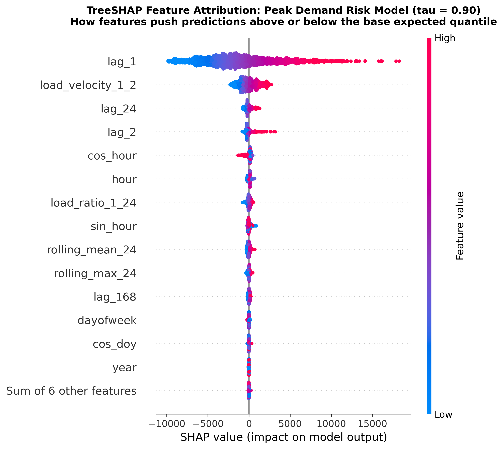
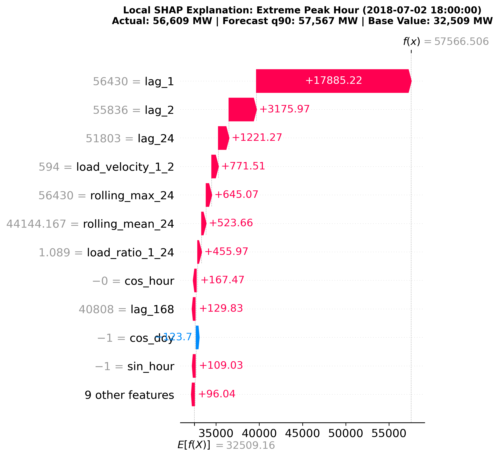

# TreeSHAP Explainability & Attribution Analysis (AC-7)

**Model Analyzed:** LightGBM Quantile Regressor ($	au = 0.90$, Peak / Blackout Risk Margin)  
**Method:** TreeSHAP (Lundberg et al., Nature Machine Intelligence 2020)  
**Background Expected Value ($E[\hat{y}]$):** 32,509.2 MW  

---

## 1. Top Attributed Features for Peak Load Risk

The table below quantifies the mean absolute SHAP value ($E[|\phi_i|]$) across the holdout test set, representing the average impact each feature has in driving the 90th percentile forecast away from the base grid expectation:

| Feature           |   Mean_|SHAP|_MW |
|:------------------|-----------------:|
| lag_1             |       3880.15    |
| load_velocity_1_2 |        868.014   |
| lag_24            |        341.468   |
| lag_2             |        301.001   |
| cos_hour          |        207.117   |
| hour              |        144.243   |
| load_ratio_1_24   |        136.953   |
| sin_hour          |        124.996   |
| rolling_mean_24   |        119.828   |
| rolling_max_24    |         88.0785  |
| lag_168           |         73.2929  |
| dayofweek         |         37.9184  |
| cos_doy           |         33.9701  |
| year              |         25.4827  |
| dayofyear         |         15.3688  |
| rolling_std_24    |         13.5926  |
| sin_doy           |          7.01231 |
| is_weekend        |          6.70258 |
| month             |          2.69699 |
| is_holiday        |          0.10308 |

---

## 2. Visual Attributions

### A. Global Beeswarm Feature Attribution
The beeswarm plot reveals both feature magnitude and directionality. High values of `lag_1` and `rolling_mean_24` (red dots) strongly push the 90th percentile prediction upward by several thousand megawatts.

### B. Extreme Peak Stress Waterfall Analysis
On **2018-07-02 18:00:00**, the PJM East grid experienced its highest test demand of **56,609.0 MW**. The waterfall plot below decomposes how each individual feature escalated the model forecast from the baseline expectation of 32,509 MW up to the peak alert level of 57,567 MW:

